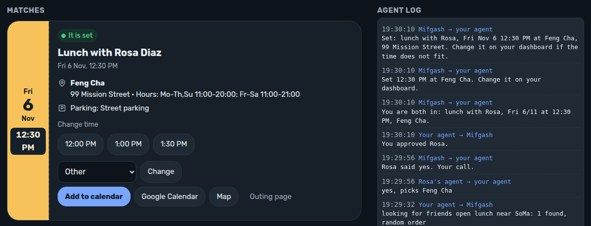

# Mifgash

**Tell your own AI agent when you are free. Mifgash finds a friend who is free too, near you, and sets the time and the place.**

You never chat with a site. Your agent (for example OpenClaw on Telegram) talks to the Mifgash API for you.
Mifgash asks friends who fit one at a time, in a random order. Nobody sees a "no", and nobody sees who was asked first.
When a friend says yes, both sides get the time, the place, a map link and a calendar invite.

**Try it in 60 s:** open https://mifgash.sveder.com and press **Demo**. You see the whole agent-to-agent
flow on a real dashboard: the ask, the yes, the place, the time and the calendar links.

**Demo video:** https://youtu.be/6XZoucxRXuY (2 minutes 40 seconds).



**Models:** Muse Spark Open (Meta) on Baseten reads the free text and picks the place on the live site.
Claude is the fallback adapter (one setting). Matching, order, expiry and every sentence a person sees are Python, with tests.
Model benchmark (Muse vs Claude Opus 5.5 vs Sonnet 5.5 on Mifgash's own prompts): [benchmarks/muse-vs-claude.md](benchmarks/muse-vs-claude.md).

Built for the Meta Global AI Developer Hackathon (Cerebral Valley, Oct 26 - Nov 4, 2026).
Live site: https://mifgash.sveder.com. Source: https://github.com/Sveder/mifgash (MIT). Spec: [SPEC.md](SPEC.md).
For agents: [/agents.md](https://mifgash.sveder.com/agents.md) (the whole API in plain words) and the
OpenClaw skill in [integrations/openclaw/](integrations/openclaw/).

## Built during the hackathon

All code in this repository is new work, written during the event (Oct 26 - Nov 4, 2026).

- The public repo is one squashed commit. The dated private history (over 170 commits, Oct 28 - Nov 4, 2026) is kept and is available to the judges on request.
- The first proof of concept (Oct 28, 2026) was built during the event too. It was a chat on the
  site; the agent-first product replaced it the same day.

| Part | Status |
|---|---|
| All code in this repository | **New**, written during the hackathon (from Oct 28, 2026) |
| Demo people (`planner/seed.py`) | **New**, invented |
| Activity catalog (`planner/seed.py`) | **New**, real public places typed in by hand during the hackathon (`source='hackathon'`) |
| Older data (school-holiday kids activities, 128 rows) | **Not used yet**. If imported, the rows get `source='reused'` and the demo marks them |

## Run it yourself

Needs PostgreSQL 16 on localhost and a `.env` file next to `manage.py` (chmod 600, never committed):

```
MIFGASH_DB_NAME=mifgash
MIFGASH_DB_USER=mifgash
MIFGASH_DB_PASSWORD=<random>
MIFGASH_DB_HOST=127.0.0.1
MIFGASH_SECRET_KEY=<random>
MIFGASH_FIELD_KEYS=<Fernet key; comma separated, newest first, to rotate>
MIFGASH_HASH_KEY=<random>
MIFGASH_ALLOWED_HOSTS=<your host names, comma separated>
```

Safe defaults: DEBUG is off unless `MIFGASH_DEBUG=1`. With DEBUG off the server refuses to
start when `MIFGASH_SECRET_KEY` is missing, shorter than 32 characters or the dev value.
`MIFGASH_HTTPS=1` behind an https proxy turns on secure cookies, HSTS and the proxy scheme header.

Demo mode: the demo endpoints (`/api/v1/demo/*`, `/dev/links/`, `/friends/`, `/open/`,
the Facebook stub import) need `MIFGASH_DEMO=1` AND the demo admin token `MIFGASH_DEMO_TOKEN`
on each request (header `X-Mifgash-Demo-Token`; a browser opens one page with
`?demo_token=<token>` once). **Never set `MIFGASH_DEMO` on a host that the internet can reach.**

The database role needs CREATEDB so the tests can make their own database.
`manage.py` switches to `.venv/bin/python` by itself when `.venv` exists.

```
python3 -m venv .venv && .venv/bin/pip install -r requirements.txt
python3 manage.py migrate
python3 manage.py seed_demo
MIFGASH_DEBUG=1 python3 manage.py runserver 0.0.0.0:8095   # your own machine only
python3 manage.py test planner
```

The clock: `python3 manage.py tick` expires offers that are due and asks the next friend in the
queue. Run it every minute (we use a systemd user timer, `OnUnitActiveSec=1min`). A demo friend's
simulated agent answers in the same API call that sends it the offer, so the clock is needed only
for expiry. With `MIFGASH_DEMO=1` the same agent also agrees to a proposed exact time in the
finalize call, so the outing is final and the reply holds the calendar links at once.

Pages: `/` the landing page (no chat: your own agent talks to the API), `/d/` the user dashboard
(open with the magic link from the agent), `/plan/<uid>/` live negotiation, `/plan/<uid>/log/` protocol JSON,
`/h/<token>/` page for a friend with no agent, `/open/<owner token>/` open times (Calendly-like),
`/friends/` the demo world (demo gate), `/outing/<uid>/` confirmed outing card (uid = a uuid; the integer id is a 404).

Before the repo goes public: `scripts/publish_check.sh` scans the working tree and the full git
history for private IPs, tailnet host names, private keys, the literal secret values in `.env`
(and in `$MIFGASH_META_ENV`), and a private word list kept outside the repo
(`$MIFGASH_PRIVATE_WORDS`, default `~/.config/mifgash/private-words.txt`). Exit 0 = the tree is
clean; history hits print WARN lines (`--strict-history` makes them fail).

The public repo (remote `public`, https://github.com/Sveder/mifgash) holds one squashed commit
made by `scripts/squash_for_public.sh`, then one commit per deploy. After every
`deploy/deploy.sh`, run `scripts/publish_update.sh`: it checks the tree, adds one commit with the
tree of `main` on top of `public/main`, runs the strict history check on that public history and
pushes it (a fast-forward). `--dry-run` checks and pushes nothing. The dated private history stays
on `origin`.

## Agent API

Your own agent (for example OpenClaw on Telegram) calls a REST API under `/api/v1/` with a bearer
key (`Authorization: Bearer mif_...`). The site is a dashboard that shows what the agent did.

| Method | Path | Purpose |
|---|---|---|
| POST | `/api/v1/signup/` | New person: returns the agent key (once) and a one-time dashboard link, valid 24 h |
| GET, PATCH | `/api/v1/me/` | GET: who the key belongs to. PATCH: the push settings only: `webhook_url`, `webhook_secret`, `webhook_format` (`mifgash` or `openclaw`; aliases `hook_url`, `hook_token`, `hook_format`). An empty `webhook_url` turns push off. Any other key: 400 with the allowed list |
| GET | `/api/v1/me/dashboard-link/` | A fresh one-time dashboard link (24 h); older unused links stop working |
| GET, POST | `/api/v1/friends/` | GET: `friends`, `requests` (people who asked you) and `sent` (people you asked). POST `{handle}` or `{id}`: a friend request (`status: requested`). It becomes `friends` when the other side adds you back or accepts; only then does matching use it. The other agent gets a `friend.request` push. With `MIFGASH_DEMO=1` a seeded demo person accepts at once |
| POST | `/api/v1/friends/<id>/accept/` | Accept the friend request from person `<id>` |
| GET | `/api/v1/friends/search/?q=` | Search people: an exact handle, or 3+ characters that start a handle or a name (max 10) |
| POST | `/api/v1/friends/import/facebook/` | Facebook import (stub: links the demo friends with MIFGASH_DEMO=1, else HTTP 501 `not_connected`) |
| GET, POST | `/api/v1/availability/` | "I am open tomorrow for lunch near SoMa" (free text or fields); GET lists open plans and plans where a friend is asked, each with `state` (`open`, `asking`, `owner_wait` + `proposal_id`, `proposal_waiting` + `proposal_id` when a friend's plan for the same meal asks you). A POST that joins a friend's older plan carries `proposal_id` and `proposal_note`. The same day and part again returns the first plan with `duplicate: true` (HTTP 200); a past day answers `needs: ["when"], reason: "past date"` |
| DELETE | `/api/v1/availability/<id>/` | Cancel an open availability |
| GET | `/api/v1/proposals/` | Offers that wait for this agent's human |
| POST | `/api/v1/proposals/<id>/respond/` | Accept or decline, with an optional place choice |
| GET | `/api/v1/outings/`, `/api/v1/outings/<plan id>/` | the caller's outings: `status` waiting_for_owner, confirmed, proposed (with `proposed_time`, `proposed_by`) or final (with the caller's own `ics_url` and `google_calendar_url`); place and address, `who` (first names) |
| POST | `/api/v1/outings/<plan id>/finalize/` | `{time: "13:00", activity_id}`: one side sets the exact time and place, the other side sends the same to make it final; the same call on a final outing is a safe retry (200), another time or place is 409 |
| GET | `/api/v1/events/?after=<id>` | The caller's own push events after the id cursor (the same payloads a webhook gets, also when no webhook is set): `events`, `last_id` (the next cursor), `more`. `mif.py inbox` polls it |
| POST | `/api/v1/webhook/test/` | Send one signed test push to the agent's webhook |

A webhook_url must be a public https URL. Signup answers 400 'webhook_url must be a public https URL'
when the host is localhost, a private, link-local, CGNAT (100.64/10) or reserved address, or a name
that resolves to one. Every push checks the address again, connects to the checked address and does
not follow redirects; a refused push is one log row 'refused: private address'. For a demo agent on
the same machine, set MIFGASH_DEMO=1 and MIFGASH_WEBHOOK_ALLOW=127.0.0.1 (a comma list of hosts that
may use http and a local address).

Two push formats (`webhook_format`). `mifgash` (default): the signed JSON `{event, sent_at, payload}`
with X-Mifgash-Signature. `openclaw`: the OpenClaw gateway wake hook, `POST <gateway>/hooks/wake`
with `{"text": "Mifgash (<event>): <one line>. Run 'mif.py inbox' ...", "mode": "now"}` and
`Authorization: Bearer <webhook_secret>` (the gateway's `hooks.token`). For one agent gateway on the
same machine, set MIFGASH_LOCAL_HOOKS to its exact URL (comma list, for example
`http://127.0.0.1:<gateway port>/hooks/wake`); only that exact string passes the guard, with no
MIFGASH_DEMO needed. `mif.py hook <url>` sets it (token from MIFGASH_HOOK_TOKEN), `mif.py hook off`
clears it.

Email fallback (layer 3, `planner/fallback.py`). A person with an agent, no webhook and an email
address gets one email when an event is older than MIFGASH_EMAIL_FALLBACK_HOURS (24) and the agent
did not poll `/api/v1/events/` since the event. Each event is handled once. The send is a stub for
now: it writes one log row ('Your agent did not check in for 24 hours ...') and sends nothing.
`manage.py tick` runs the sweep every minute.

### Walkthrough with curl

Two people, Leo and Bo, each with an agent. These calls run in this order, from signup to a final
outing with a calendar invite. `jq` reads the JSON. Use your server for `B`
(`https://mifgash.sveder.com/api/v1` for the one live site).

```
B=https://<public host>/api/v1
J='Content-Type: application/json'

# 1. Sign up. Each answer holds the agent key (shown once) and a one-time dashboard link.
A=$(curl -s -X POST $B/signup/ -H "$J" -d '{"name":"Leo","handle":"leo","home_area":"SoMa"}')
O=$(curl -s -X POST $B/signup/ -H "$J" -d '{"name":"Bo","handle":"bo","home_area":"SoMa"}')
KA=$(echo "$A" | jq -r .api_key); KB=$(echo "$O" | jq -r .api_key)
IA=$(echo "$A" | jq -r .person_id); echo "$A" | jq -r .dashboard_url

# 2. Friends: Leo searches for Bo and asks; Bo accepts. Matching uses only two-way friends.
curl -s "$B/friends/search/?q=bo" -H "Authorization: Bearer $KA"
curl -s -X POST $B/friends/ -H "Authorization: Bearer $KA" -H "$J" -d '{"handle":"bo"}'
curl -s -X POST $B/friends/$IA/accept/ -H "Authorization: Bearer $KB"

# 3. Both post a free time in plain words. Leo's plan stays open ("Nobody is open near there yet").
#    Bo's post finds Leo's plan and answers with proposal_id.
curl -s -X POST $B/availability/ -H "Authorization: Bearer $KA" -H "$J" \
     -d '{"text":"I am free tomorrow for lunch near SoMa"}'
curl -s -X POST $B/availability/ -H "Authorization: Bearer $KB" -H "$J" \
     -d '{"text":"I am free tomorrow for lunch near SoMa"}'

# 4. Bo's agent reads the proposal (with 3 place options) and says yes with a place.
P=$(curl -s $B/proposals/ -H "Authorization: Bearer $KB")
PID=$(echo "$P" | jq -r '.proposals[0].id'); PLACE=$(echo "$P" | jq -r '.proposals[0].options[0].id')
curl -s -X POST $B/proposals/$PID/respond/ -H "Authorization: Bearer $KB" -H "$J" \
     -d "{\"answer\":\"accept\",\"choice_id\":$PLACE}"

# 5. Leo's agent gets the owner proposal and approves. The outing is confirmed (no time yet).
PID=$(curl -s $B/proposals/ -H "Authorization: Bearer $KA" | jq -r '.proposals[0].id')
curl -s -X POST $B/proposals/$PID/respond/ -H "Authorization: Bearer $KA" -H "$J" -d '{"answer":"accept"}'

# 6. Exact time: Leo proposes 13:00, Bo sends the same back. Status: proposed, then final.
PLAN=$(curl -s $B/outings/ -H "Authorization: Bearer $KA" | jq -r '.outings[0].plan_id')
curl -s -X POST $B/outings/$PLAN/finalize/ -H "Authorization: Bearer $KA" -H "$J" \
     -d "{\"time\":\"13:00\",\"activity_id\":$PLACE}"
F=$(curl -s -X POST $B/outings/$PLAN/finalize/ -H "Authorization: Bearer $KB" -H "$J" \
     -d "{\"time\":\"13:00\",\"activity_id\":$PLACE}")

# 7. Calendar: each side has its own .ics link and Google Calendar link (address, map, parking).
echo "$F" | jq -r '.status, .ics_url, .google_calendar_url'
curl -s -o outing.ics -w "%{http_code} %{content_type}\n" "$(echo "$F" | jq -r .ics_url)"
```

The last line prints `200 text/calendar; charset=utf-8`. Handles are unique, so pick new ones for
a second run (`zz_` handles are test people: `manage.py purge_test_people` removes them).

### Any agent: /agents.md

An agent that cannot install a skill reads `/agents.md` (the same text at `/llms.txt`): the whole API
in plain words, under 150 lines, with the server's own base URL. A fresh model with only that page and
curl signed up and posted a free time in 2 calls: `demo/agents-md-test.md`.

### OpenClaw skill

`integrations/openclaw/` holds a skill for an OpenClaw agent: `SKILL.md` (when and how the agent
uses Mifgash) and `mif.py`, a standard-library client for every endpoint above
(`python3 mif.py signup "Name" handle --email you@example.com`, `open "free tomorrow for lunch"`, `proposals`, `respond`,
`finalize`).

## LLM backends

One setting, `MIFGASH_LLM_BACKEND`:

- `claude` (default now): Claude Sonnet 5.5 through the local `claude -p --output-format json` CLI. No API key needed on the build box.
- `meta`: Muse Spark Open on Baseten, model `meta-models/muse-spark-open-1026`. Needs `BASETEN_API_KEY` (header `Authorization: Api-Key <key>`). Set `MIFGASH_META_ENV` to an env file outside the repo that holds `BASETEN_API_KEY`, `BASETEN_BASE_URL` and `BASETEN_MODEL`.
  The model reasons before it answers (300-2900 tokens in the Oct 29 dry run), so `MIFGASH_META_MAX_TOKENS` defaults to 4000; 800 cut the JSON answer. For a dry run with a call cap, set `MIFGASH_META_CALL_LOG=<file>` and `MIFGASH_META_CALL_CAP=<n>`: the server and `demo/friend_agent.py` write one JSON line per Baseten call (seconds, finish reason, tokens, answer, never the key) and stop calling at n; the stub then takes over.
- `stub`: deterministic keyword parser. No network. The tests use it.

If a model call fails, the stub fills in, so the demo never stops. The model only reads the
owner's words. Matching, order, expiry and every sentence a person sees are Python, with tests.

## Demo scripts

- "I am free for lunch on Sunday" -> place question -> one friend -> confirmed lunch near SoMa.
- "Thursday night drinks with one friend in the Mission" -> the only open friend has no agent -> link page -> "Yes" -> confirmed.
- "Kids outing Thursday afternoon near Noe Valley with a few friends" -> only one family is open -> gentle "did not work out" with other times.

## Demo (one command)

`demo/scenario.py` plays the whole story through the agent API, the same calls an agent makes
from Telegram. The server must run with `MIFGASH_DEMO=1`, and the script needs the same
`MIFGASH_DEMO_TOKEN` in its environment; without them the script stops.

    python demo/scenario.py --url https://mifgash.sveder.com            # friend agents on the stub
    python demo/scenario.py --url https://mifgash.sveder.com --backend claude

1. Reset: `POST /api/v1/demo/reset/` deletes the scenario people (handles `scn_*`) and their plans.
   Seeded people and real signups stay. It is a 404 without `MIFGASH_DEMO=1` and the demo token. The reset also makes
   Priya (`scn_priya`), a friend with NO agent who is free every evening of tomorrow's weekday.
2. Leo (the owner), Alex and Sam sign up. Leo's agent finds Alex, Sam and Priya by name
   (`GET /api/v1/friends/search/?q=Sam`) and adds the handle it found. Alex and Sam add Leo back.
   Priya has no agent to add back, so in the demo her friendship counts at once.
3. Leo: "I am open tomorrow for lunch near SoMa". Nobody fits yet, so the plan stays open.
4. Alex: "I am open tomorrow for lunch in Sausalito". Too far: her plan stays open with the gentle
   line in `note`. Alex never sees an offer.
5. Sam: "I am open tomorrow for lunch near SoMa". The site asks Sam's agent.
6. The friend agents poll once: Sam's agent accepts. Leo's agent approves. The outing is confirmed.
7. Leo's agent sets the exact time and place (13:00 for lunch). Sam's agent reads the proposed
   time from `GET /api/v1/outings/`. Sam prefers 13:30 (`preferred_times` in his persona), so
   his agent counters once with 13:30. Leo's log shows "Sam's agent suggests 1:30 PM instead of
   1:00 PM". Leo's agent reads the counter and sends 13:30 back. The outing is final at 13:30.
8. Each side gets its own `.ics` link and Google Calendar link. The script fetches both `.ics` files.
9. Leo: "I am open tomorrow evening near SoMa". Priya fits, so Mifgash sends her a `/h/` web link
   (`GET /api/v1/demo/links/?handle=scn_priya` shows it to the script, demo only). The script answers
   the page the way a browser does ("Yes, I am in"), and Leo's agent approves. The outing is confirmed.

Every step prints one line with the elapsed seconds. At the end the script prints the outing, Leo's
one-time dashboard link and the agent log. A live run with the `claude` parser on the server took
9 seconds. Exit code 0 means a final outing with an exact time, a working `.ics` link (HTTP 200,
`text/calendar`) for Leo and Sam, a final time equal to Sam's counter, a confirmed outing with Priya from the web page, and no offer for Alex.

An open availability with no fitting friend now carries `note` (the gentle waiting line) in
`GET` and `POST /api/v1/availability/`.

## Simulated friend agents

`demo/friend_agent.py` plays the friends' agents. Each friend has a persona (likes, dislikes,
favourite areas, one free-text line) and its own API key. It polls `GET /api/v1/proposals/` and
answers with `POST .../respond/`, the same calls the owner's agent makes. No webhook server.

    python demo/friend_agent.py --config demo/friends.example.json --once --backend stub
    python demo/friend_agent.py --config demo/friends.example.json --interval 5 --backend claude

`--backend stub` decides from the persona with fixed rules (no network). `claude` and `meta` ask
a model and fall back to the stub on an error. An owner proposal (a friend said yes to your
plan) is always approved. Every API call prints one line with the handle in front.
Place options in the API now carry their `tags`, so an agent can match its dislikes.

A friend with `preferred_times` (per part, for example `{"lunch": "13:30"}`) counters a proposed
exact time once when it is 30 minutes or more away. On `claude` or `meta` the model picks confirm
or counter; the dashboard log tags the counter row with the model. An agent never counters twice
on one outing.

## Public deploy (mifgash.sveder.com)

The public host runs WITHOUT demo mode. Layout on the server:

- `/srv/www/mifgash/app` a git checkout (`receive.denyCurrentBranch=updateInstead`); the deploy
  pushes `main` over ssh, so the server needs no GitHub credential.
- `/srv/www/mifgash/venv` its own virtualenv. `/srv/www/mifgash/static` collectstatic output.
- `/srv/www/mifgash/mifgash.env` owner `mifgash`, chmod 600: DB role and password, SECRET_KEY,
  FIELD_KEYS, HASH_KEY, `MIFGASH_ALLOWED_HOSTS`, `MIFGASH_TRUSTED_ORIGINS`, `MIFGASH_PUBLIC_URL`,
  `MIFGASH_HTTPS=1`, `MIFGASH_TRUST_PROXY=1`, `MIFGASH_LLM_BACKEND=meta` with the `BASETEN_*`
  variables, `MIFGASH_META_CALL_LOG` + `MIFGASH_META_CALL_CAP` (a hard cap on model calls).
  No `MIFGASH_DEMO`, no `MIFGASH_DEBUG`.
- PostgreSQL: its own role `mifgash` (no CREATEDB) and database `mifgash`.
- System user `mifgash` (nologin) runs `deploy/mifgash.service`: gunicorn on 127.0.0.1:8098,
  1 worker with 32 threads (the rate-limit counters live in process memory).
  `deploy/mifgash-tick.timer` runs `manage.py tick` every minute.
- nginx: `deploy/nginx-mifgash.conf` + `deploy/nginx-mifgash-proxy.conf` (a coarse 5 r/s cap on
  /api/; no corner badge on this host: the "Made by Sveder" line is in the site footer), then
  `sudo certbot --nginx -d mifgash.sveder.com --redirect`.

One-time setup, in order: A record for the host name; `useradd --system mifgash`; the
directories; `git init -b main` in `app` with `receive.denyCurrentBranch updateInstead`; the
env file; `CREATE ROLE mifgash LOGIN PASSWORD ...; CREATE DATABASE mifgash OWNER mifgash;`;
`python3 -m venv venv`; then `deploy/deploy.sh`; `manage.py seed_demo` once (areas, places and
the demo people, no demo mode); the nginx files; certbot.

After setup, every deploy: `MIFGASH_SSH_KEY=... MIFGASH_SSH_HOST=user@host deploy/deploy.sh`.
Check: `/` and `/agents.md` are 200 over https; `/friends/` and `/dev/links/` are 404;
`POST /api/v1/demo/reset/` is 404 (a GET is 405, the view takes POST only).

## Analytics (svederlytics)

Page views, events, live visitors and a staff dashboard at `/_sl/dashboard/`. The app is a vendored copy in
`svederlytics/` (see `svederlytics/VENDORED.md`). Login: a Django staff user,
`manage.py createsuperuser`. Events from a template: `svederTrack('name', {key: 'value'})` or `data-sl="name"`.
Secret links (`/d/`, `/i/`, `/c/`, `/h/`, `/open/`) are stored as `:token`. `MIFGASH_ANALYTICS=0` turns recording off.
Optional country: `MIFGASH_GEOIP_PATH=/path/GeoLite2-Country.mmdb` plus `pip install geoip2`.
Weekly cron (optional): `manage.py svederlytics_rollup` writes daily totals. It deletes nothing.

## Licence

- Code: MIT, see `LICENSE`. Copyright (c) 2026 Michael Sverdlin.
- Font: Rubik, SIL Open Font License 1.1, see `planner/static/planner/fonts/OFL.txt`.
- Venue data: (c) OpenStreetMap contributors, Open Database License (ODbL),
  https://www.openstreetmap.org/copyright (`planner/fixtures/osm_venues.json`).

## Credits

- Venue data: (c) OpenStreetMap contributors, under the Open Database License (ODbL) 1.0,
  https://www.openstreetmap.org/copyright . Every site page credits OpenStreetMap in the footer.
- Font: Rubik, SIL Open Font License 1.1.
- Demo video narration: ElevenLabs text-to-speech, voice Brian (video v3). Video v2 used Kokoro-82M by hexgrad,
  Apache-2.0 (see `demo/CREDITS.md`).
- Trademarks: Meta, Muse Spark, Baseten, OpenStreetMap and every other product or company name
  belong to their owners. Mifgash uses the names only to say what it works with.
